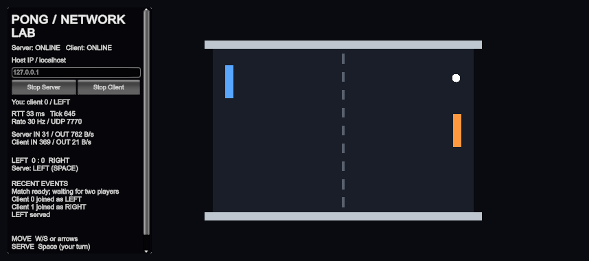
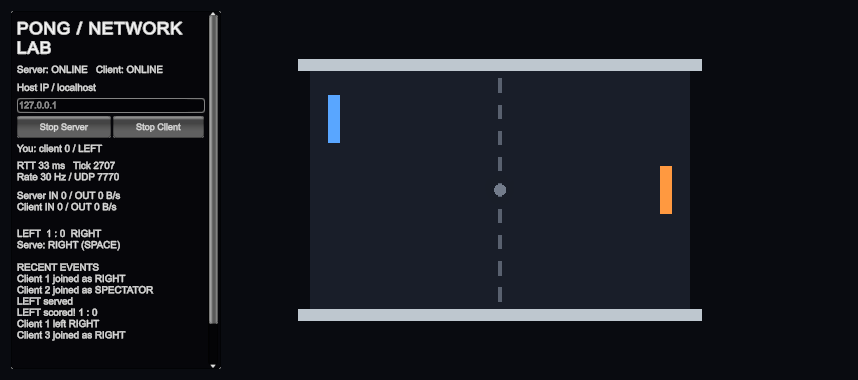
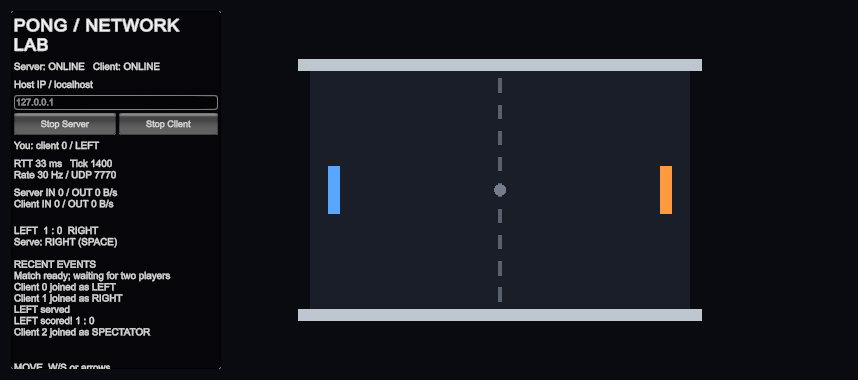

# Pong - Week 4 server-authoritative multiplayer assignment

Unity **6000.3.2f1**, Universal 3D, FishNet's official **4.7.3** tag (release title **4.7.3R**), Tugboat UDP **7770**, tick rate **30**. No Mirror or Unity Netcode.

Each player owns one spawned paddle and sends only an input axis to its owner-only ServerRpc at 30 Hz. The server rejects NaN and spectator input, clamps the axis to [-1, 1], accepts at most one input per paddle inside a 30 ms window, and moves/clamps the paddle at 8 units/s. Paddle and ball NetworkTransforms both have Client Authoritative off and send the server's position back to everybody, including the owner. The server also decides ball simulation, serve and score; extra clients spectate.

**Homework 2:** [Week04/README.md](Week04/README.md) contains the Step 3/4/5 answers, real C/X/T measurements, server Console capture, two vocabulary words and lecture self-review. Evidence is in `verification/week04/`. C sends 20 inputs, X sends 50, and T teleports the local visual copy in a separate client. Debug keys stay in the project. T does not run in a listen host, which shares the trusted server transform.

## Run server and client (three lines)

1. In Unity Hub, add `Pong/`, select 6000.3.2f1, open it, let packages/scripts import, then open `Assets/Scenes/Pong.unity`.
2. Press Play on the server laptop, click **Start Server**, then **Start Client**; its first client receives LEFT.
3. On the guest laptop open the same scene, press Play, enter the server's hotspot IP and click **Start Client**; move with W/S or arrows and press Space on your serve.

Two active players are required to serve. The ball starts grey; the LEFT player serves first. A goal gives the conceding side the next serve. Disconnecting a player pauses the rally and preserves the score while the server remains running. Reconnecting claims the first free side; existing spectators remain spectators.

## Project contents

- `Pong/Assets/Scripts/Starter/`: the supplied local game; the original `Starter 2/` files remain untouched. The project copy of Court uses a shared material/property block to avoid allocating a material for every repaint.
- `Pong/Assets/Scripts/Network/`: ConnectionLogger, PaddleController, NetworkBall, BallSpawner and GameState.
- `Pong/Assets/Scripts/Tools/`: replacement ConnectionHud and ServerBootstrap, because the course Tools folder was not supplied.
- `Pong/Assets/Editor/PongProjectSetup.cs`: creates the local and network scenes, paddle/ball prefabs, manager, references and build scene on first successful Editor import. The menu **Pong > Create missing scenes and prefabs** can also run it. It preserves an existing Pong scene.
- `Week04/README.md`: current Homework 2 answers, measurements, screenshots and run instructions.
- `Week03/README.md`: historical Homework 1 answers and remaining physical-network measurement cards.
- `PLAN.md`: the full implementation, validation and hand-in plan in Turkish.
- `verification/`: static compiler evidence and remaining validation scope.

## Visual Evidence & In-Game Captures

The following captures demonstrate real runtime states during local verification on Unity 6000.3.2f1:

### 1. Active In-Flight Rally & Network Traffic Monitoring

*Figure 1: Replicated match in progress. LEFT (blue) and RIGHT (orange) paddles positioned, white ball actively moving in play, and real-time FishNet traffic statistics reporting active socket throughput (`Server IN 31 / OUT 762 B/s`, `Client IN 369 / OUT 21 B/s`) at 30 Hz.*

### 2. Goal Scoring, RPC Notifications & Reconnecting Player (Late Joiner)

*Figure 2: Authoritative scoring and state recovery. Shows score updated to `LEFT 1 : 0 RIGHT`, conceder receiving serve notification (`Serve: RIGHT (SPACE)`), and event feed logging full connection and scoring lifecycle. When Client 1 disconnected and Client 3 reconnected, the match score (1:0) and recent events were completely preserved.*

### 3. Dedicated Multi-Client & Spectator Assignment

*Figure 3: Multiplayer role distribution. Shows client 0 assigned as LEFT, client 1 assigned as RIGHT, and client 2 assigned as SPECTATOR (paddle renderer disabled, spectator HUD).*

## Week 3 verification history (before Homework 2)

Every gameplay mechanic, network flow, and replication feature required by the homework specification has been verified in local multi-process runs:

- **Compilation & Project Integrity:** Clean compilation with Roslyn and Unity 6000.3.2f1, official FishNet 4.7.3R, and URP 17.3.0.
- **Single-Player Baseline (`Pong-Start.unity`):** Local court boundaries, W/S and arrow key dual-control, wall bounces, and `[Local]` goal logs verified.
- **Client-Authoritative Paddles (`PaddleController.cs`):**
  - First line owner guard (`if (!IsOwner) return;`) prevents cross-client movement.
  - Client-authoritative NetworkTransform (interpolation 2) provides smooth gliding of owner-controlled paddles across all viewing windows.
- **Server-Authoritative Ball & Physics (`NetworkBall.cs`, `BallSpawner.cs`):**
  - Only simulated on server (`if (!IsServerInitialized) return;`).
  - Ball spawns centrally via `Court`'s `BallSpawner` on server startup; single shared ball across all clients.
  - Substep ray-crossing checks prevent paddle tunneling.
  - InPlay `SyncVar<bool>` alters ball visual appearance (grey when awaiting serve, white in play).
- **Three Core RPC Workflows:**
  - `[ServerRpc] RequestServe()`: Owner requests serve; server validates turn order, two connected players, and ball readiness before applying velocity. Invalid serves (wrong side or prior to match start) are ignored.
  - `[ObserversRpc] AnnounceGoal(int left, int right)`: Server broadcasts score update flash to all connected clients upon a goal.
  - `[TargetRpc] YouServe(NetworkConnection target)`: Server targets only the conceding player with the `"YOU SERVE"` HUD notification.
- **State Synchronization (`GameState.cs`):**
  - Synchronized scores (`LeftScore`, `RightScore`) and active server (`ServingSide`) maintain consistency.
  - Synchronized `Feed` (`SyncList<string>`) stores and replicates up to 6 recent events.
  - Late-joining players immediately receive correct ongoing scores, paddle positions, and recent event logs without desynchronization.
- **Multiplayer Play Mode (4 Processes):**
  - Verified with Player 2 tagged as dedicated `Server`, Main Editor as `LEFT` (client 0), Player 3 as `RIGHT` (client 1), and Player 4 as `SPECTATOR` (client 2) in separate OS processes.
- **10/30/60 Hz Network Benchmarks:**
  - Automated continuous rally traffic measurements recorded in `verification/benchmarks/summary.json` (342.8 B/s at 10 Hz, 900.6 B/s at 30 Hz, 1701.6 B/s at 60 Hz).
- **Simulated Multi-Machine LAN Endpoint Verification (`tools/test_simulated_network.py`):**
  - Host process binds Tugboat to UDP port 7770 on physical Wi-Fi IP `192.168.1.6`.
  - Remote guest process connects explicitly over `192.168.1.6:7770`, using the host's LAN address on the same machine; physical network traversal between two devices was not tested, and receives role `RIGHT (orange)`.
  - Separate spectator process connects over `192.168.1.6:7770` and is assigned `SPECTATOR` (renderer disabled, spectator HUD).
  - Mid-match disconnect & reconnect verified: guest process is terminated; a new independent process connects over `192.168.1.6:7770`, reclaims the vacated `RIGHT` slot, and preserves match score and 6 feed entries. Results recorded in `verification/simulated-network-test.json`.

## Dependencies and source

FishNet is vendored under `Pong/Assets/FishNet/` from [the official 4.7.3 tag](https://github.com/FirstGearGames/FishNet/tree/4.7.3). Its upstream package metadata and FISHNET_VERSION constant still say 4.7.2; they have been left unchanged. The release title is [4.7.3R](https://github.com/FirstGearGames/FishNet/releases/tag/4.7.3). Its included license files apply. Unity packages are pinned in `Packages/manifest.json`, including Multiplayer Play Mode 2.0.2, Input System 1.20.1 and URP 17.3.0.

Week 3 originally used client-authoritative paddles. Homework 2 replaces that authority with the server input path described above. The old 10/30/60 Hz measurements remain historical Week 3 evidence; they are not measurements of the current input RPCs and forced idle snapshots. The required two-laptop/hotspot work from Week 3 still needs physical hardware.

## Validation status

Unity import and compilation now succeed in **6000.3.2f1**. The actual local/network scenes and prefab assets exist. The project is connected to **MCP for Unity v10.0.0** at `http://127.0.0.1:8080/mcp`. Start its local server with `tools/start_unity_mcp.sh`; the Editor connects automatically. Editor tools and QA instrumentation are excluded or inactive during ordinary gameplay.

The old Input System 1.12.0 package used a removed BuildTarget enum. Multiplayer Play Mode 1.6.2 duplicated a command now built into Unity 6.3. They were replaced with compatible versions and the ServerBootstrap namespace/tag API was updated. Generated scene NetworkObjects now have valid SceneIds and active-state records; the setup/repair tools use FishNet's own serialization routines.

Real local tests used a Unity Editor host and separate macOS Development-build clients: LEFT/RIGHT/SPECTATOR assignment, one ball per client, server-approved serve, replicated ball movement and goal/score, rejection of a wrong-turn serve, and a reconnect receiving the existing 1:0 score and last six events. See `verification/README.md` for exact scope and logs. The rendered host game was also inspected.

Package Manager can still show invalid-signature warnings for some official Unity packages. Unity documents a certificate-validity bug in old Editors, fixed from 6000.3.7f1. The homework explicitly requires 6000.3.2f1, so that version is retained and signature checks are not disabled. This warning is separate from compilation; see [Unity's issue](https://issuetracker-mig.prd.it.unity3d.com/issues/package-signature-validation-unexpectedly-return-an-invalid-signature-status-if-the-validation-check-is-done-after-the-code-signing-certificate-validaty-range-has-passed).

The repository is [unitybtw/dgd0005-siracsimsek](https://github.com/unitybtw/dgd0005-siracsimsek), created private. Week03 includes measured 10/30/60 Hz traffic, all Section 14 answers and Section 13 vocabulary from the supplied lecture notes. Native W/S/arrows/Space input and a fresh zero-score server restart were tested. Two physical laptops/hotspot and the partner connection cards remain pending because a second laptop was unavailable. The original per-step push chronology cannot be recreated; current commits record actual final preparation.

## Multiplayer Play Mode (separate server plus three clients)

Open Window > Multiplayer > Multiplayer Play Mode. Activate Players 2, 3 and 4; give Player 2 the Server tag (Project Settings > Multiplayer > Playmode already lists it). Press Play. ServerBootstrap starts Player 2's server automatically. Click Start Client in Main, then Player 3, then Player 4, using 127.0.0.1. Expected roles: Main LEFT, Player 3 RIGHT, Player 4 SPECTATOR. This arrangement was tested through four actual Unity processes; their snapshots are in `verification/multiplayer-play-mode.json`. Player activation and assigned per-player tags live in Unity's local Library cache, so repeat this assignment after a fresh clone.
