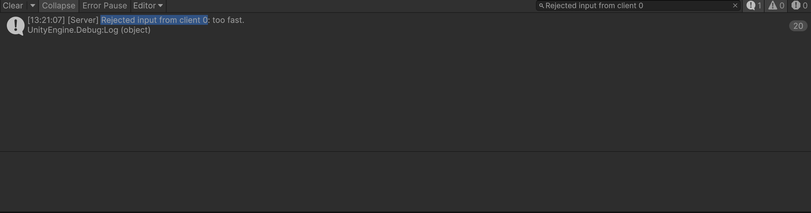
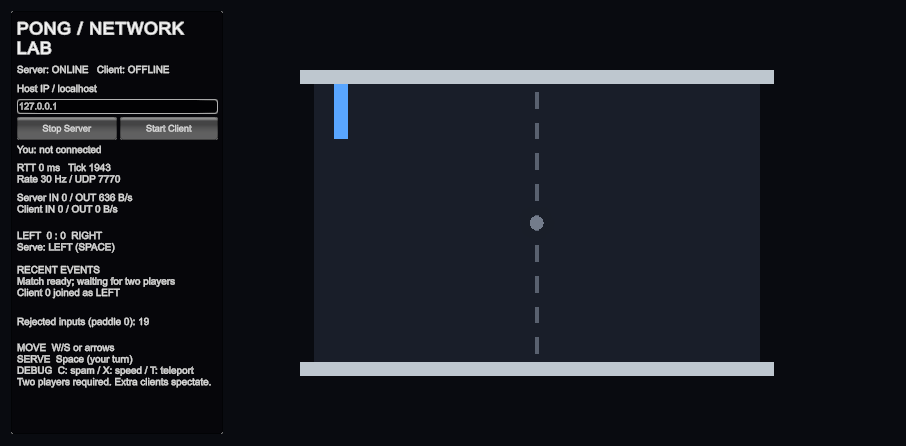

# Week 4 - Homework 2: The server decides

This continues the working Week 3 FishNet Pong project in `Pong/` using Unity 6000.3.2f1 and 30 Hz. The target is server-authoritative paddle movement, validated input, an independent 30 ms input limit per owned paddle, and retained C/X/T cheat demonstrations.

Separate answer sheet: [ANSWERS.md](ANSWERS.md). Opening/importing: [IMPORT.md](IMPORT.md).

## Implementation steps

- Baseline: Homework 1 scenes, ball, score and serve are present. Previous verification is retained in `verification/`.
- Step 1: turn off client authority on the paddle prefab; retain server authority on the ball.
- Step 2: send an axis every network tick, including zero; move and clamp only on the server.
- Step 3: reject NaN and spectator input; clamp the axis to [-1, 1].
- Step 4: reject additional input within 30 ms using a per-paddle timestamp; count and log rejections.
- Step 5: retain C (20 requests), X (axis 50), T (local teleport); record real multiplayer results and a server Console screenshot.

Each implementation step is committed and pushed separately during this work. Measured results and answers are recorded below. A physical partner test and a deadline/on-time claim are not inferred from local testing.

## Step 1 result

Both prefab NetworkTransforms have Client Authoritative off. In three-process Multiplayer Play Mode (server + two clients), queued W moved only the old client-local copy to z=4; the server retained LEFT z=0 and RIGHT z=0. This is the expected loss of client movement authority before adding input RPCs. FishNet suppresses unchanged transform sends, so an idle server did not immediately correct that local visual change. Evidence: `verification/week04/step1.json`.

## Step 2 result and RTT

Movement now runs in `OnTick` on the server using `speed * TimeManager.TickDelta`; the owner sends an axis every tick, including zero. Tick callbacks are subscribed in `OnStartNetwork` and removed in `OnStopNetwork`. Initial placement also writes position only on the server. The opt-in benchmark bot now queues keyboard input instead of writing client positions.

In three-process Multiplayer Play Mode, W sent from LEFT moved the server's LEFT paddle (z=0.8000001 at an intermediate snapshot), while RIGHT stayed at zero. Both client views subsequently received LEFT z=4, the court limit. Releasing W sent zero and retained that position. The local RTT HUD counter measured **0 ms** (loopback, rounded integer; not zero total input/display delay). Tick scheduling and the NetworkTransform interpolation buffer also add delay. No physical-network RTT is claimed.

## Step 3 - Check the input

If the server receives `axis = 50`, `axis = Mathf.Clamp(axis, -1f, 1f);` changes it to 1. This line runs on the **server**, inside the owner-only `[ServerRpc] ServerSetAxis`. The server's tick then multiplies the accepted axis by its own speed (8 units/s) and tick duration. NaN returns before any state change, and a spectator request returns before writing `_serverAxis`. Positive/negative infinity is also reduced to +1/-1 by the clamp. Client-side presentation never decides server speed.

## Step 4 - Why 30 ms?

At 30 Hz a regular keyboard request arrives every 33.33 ms. A 30 ms minimum accepts that cadence while rejecting multiple requests processed in one server tick. The clock is `TimeManager.TicksToTime(TimeManager.Tick)` on the server; a client cannot supply the timestamp. `_lastInputTime` is an **instance** field on each owned paddle, so one player's spam cannot consume the other player's allowance. `[ServerRpc]` retains FishNet's default ownership check.

- **5 ms:** still rejects requests in the same server tick, because this clock has tick resolution, but allows requests on every distinct tick; it is a weaker minimum if tick rate rises. It does not measure sub-tick 5 ms spacing.
- **500 ms:** accepts only about two inputs per second, rejects normal 30 Hz input, and holds stale directions for too long; movement and stopping feel unresponsive.

Well-formedness/range and the required spectator guard run first; the time check runs before `_serverAxis` changes. In requests with further game rules, validate them after rate accounting, then write state and announce. Here axis is input memory; the server tick performs movement. Each rejected rate-limited request increments `RejectedInputs` and logs the specified message. Server HUD panels are added on start and removed on stop/destruction so reconnects do not leak stale counters.

## Step 5 - Cheat explanations

1. **C:** twenty RPCs only try to replace the stored `_serverAxis`; they never move the paddle themselves, and the server simulates movement once per tick at its own speed, so even without the rate limit twenty requests cannot multiply speed by twenty.
2. **T:** the client writes its own visual copy, while ball collisions use the unchanged authoritative paddle in the separate server process; client position is never sent upstream.
3. **Without the rate limit:** X still fails because the server clamps 50 to 1, and T still fails because the server controls NetworkTransform state; C still cannot increase movement speed, but its excessive requests would no longer be refused or counted.

The normal tick send is skipped once after C, so a C press sends twenty requests instead of accidentally sending twenty-one with the regular input. X queues one axis-50 request for the next owner tick, replacing its ordinary axis instead of racing a zero-input packet between ticks. Server validation and the 30 ms limit are unchanged. Normal keyboard play still sends an axis, including zero, every tick. Arrival batching can put a prior packet in the same server tick; use the counter delta and tick evidence when interpreting a run.

FishNet normally stops sending unchanged transforms. For the T demonstration, the server forces a fresh authoritative paddle snapshot each tick, including while idle. `CorrectVisualDrift` snaps visual errors over one unit to an actual received server snapshot; ordinary movement retains NetworkTransform interpolation. This increases paddle snapshot traffic. It never writes server state from the client. T is restricted to a separate client (`!IsServerInitialized`), because a listen host shares the authoritative transform and is a trusted server process, not a remote cheating client.

## Lecture self-review (Week 4, Section 12)

1. **Week 3 cheats:** teleporting to the ball, moving faster than the permitted speed, and moving outside the court were possible when the server relayed owner positions. Turn off Client Authoritative and accept validated input for server simulation to remove this position authority.
2. **Editing score locally:** `LeftScore.Value = 99` in a client process cannot send a server-authoritative SyncVar write to other machines. It may change only the local display (or be refused by that SyncVar's write permissions); it never changes the authoritative score. A subsequent authoritative synchronization restores the received value. With change-only replication, do not assume an immediate correction while the server value stays unchanged.
3. **Authority does not fix:** a wallhack reading positions already delivered to a client requires observer/visibility rules that avoid delivering hidden information. Aimbots and macros using legal inputs require detection and game-specific policy. Request spam needs a per-client rate limit in addition to state authority.
4. **Input delay:** key -> next owner tick -> input packet to server -> validation -> server simulation tick -> position packet back -> interpolation/render frame -> screen. Outbound plus inbound transport is approximately one RTT, with tick/frame queues and interpolation added.
5. **Request checks in this game:** owner authentication (FishNet RPC dispatch); well-formed NaN/range checks; per-paddle rate check; game permission (spectators cannot move), then write the accepted axis and simulate. The homework specifically places its spectator early-return alongside the Step 3 checks, before time accounting. For serve: valid active player, rate if implemented, your turn/two players/ball idle, then serve and announce. The optional one-second serve limiter is not implemented.
6. **Cloud ports:** the provider's security list and the guest OS firewall are independent network barriers; both must permit incoming UDP 7770. Container hosting may map a different public UDP port to the game's internal 7770, so a remote client uses the public mapping. This answer does not claim a deployment.
7. **Dedicated Server paths:** do not require a renderer, camera, UI, audio or `Keyboard.current` on the server. Use `#if !UNITY_SERVER` for presentation and keyboard code, `#if UNITY_SERVER` for server startup, and null/role checks for shared code. In this homework the owner guard keeps keyboard reads out of a server-only paddle tick; `Keyboard.current` is also null-checked. The verified build is a macOS Development player, not a Linux Dedicated Server build.

## Two vocabulary words and the pointed-at line

- **Authority:** the machine permitted to decide a piece of game state. Here the server decides paddle position, ball simulation and score.
- **Rate limit:** a server-enforced minimum interval between accepted requests for one caller. Here each owned paddle stores its own last accepted server time.

Be ready to point at and explain:

```csharp
if (_lastInputTime >= 0 && now - _lastInputTime < MinInputGap)
```

`now` comes from the server tick clock, `_lastInputTime` belongs to this paddle, and `MinInputGap` is 0.030 seconds. A request inside that interval increments the counter and returns before changing `_serverAxis`. Also explain `speed * (float)TimeManager.TickDelta`: distance per server simulation tick, independent of client frame rate or number of RPCs.

## Measured results (18 October 2026)

The final implementation was exercised through a Unity Editor **server only**, two separate macOS Development player clients, and an additional spectator. W/C/X/T/Space were also pressed using native OS keyboard input in the visible LEFT client. The optional probe's command files exercised the other player, NaN and spectator spam. Earlier Step 1/2 movement was checked in three actual Multiplayer Play Mode Editor processes.

| Check | Observed result |
|---|---|
| C, native keyboard | Server tick 1675: counter +19; LEFT z 2.9333334 -> 3.2000000 (8 / 30 units). |
| X, native keyboard | Server tick 2378: LEFT z 3.2000000 -> 3.4666667; no extra rejection in that tick. Axis 50 never produced faster movement. |
| T, native keyboard | Client briefly moved to the ball at (0, 0.25, 0), then returned to (-7, 0.5, 3.4666667) after **5.542 ms**, within one 33.33 ms tick in this local run. Server LEFT x stayed -7. |
| Independent timestamps | Tick 5477: LEFT spam counter +19 while RIGHT moved -0.2666667 in the same tick. |
| Maximum observed server speed | **8.0000031 units/s** across recorded tick-to-tick samples; floating-point rounding around the configured 8. |
| Limits and invalid input | Every sampled server position was finite and z stayed within [-4, 4]. NaN was sent through the real owner RPC; spectator C requests produced no movement and its counter stayed zero. |
| Serve and scoring | Native Space started a rally; the server and LEFT/RIGHT/SPECTATOR all received LEFT 1 : 0 RIGHT. |
| RTT | Initial MPPM snapshot: 0 ms (rounded loopback counter). Native T snapshot: **13 ms**. A standalone HUD also showed 33 ms during startup. These are local readings, not WAN measurements. |
| Final import/build | Unity 6000.3.2f1 macOS Development build succeeded; final Console error query returned zero. |

**Load limitation:** this intentionally instrumented run produced more background rejections than the handout's occasional one or two per minute, particularly during synchronous MCP/Editor operations and packet catch-up. Those packets are genuinely rejected by the required tick-clock limiter. The tables report the **per-tick counter increase**, not a clean-play zero-count claim or a claim that every rejection is a cheat. Under loaded/batched delivery, a C burst can overlap a previous ordinary input and produce 20 rejections; the recorded normal-play example above produced exactly 19. The required 30 ms rule was retained.

### Server Console after one C



This is a real Unity Console framebuffer capture, with Collapse enabled and the row count **19**, filtered to client 0. For this isolated screenshot, the opt-in QA probe temporarily unsubscribed only the separate client's ordinary tick sender, then queued one C key press through Unity's Input System. This removes unrelated zero-input packets from the count. The server's simulation tick, RPC ownership check and `ServerSetAxis` validation/rate limit ran unchanged. The normal-input native C test is separately evidenced at tick 1675 above.



The screenshot run used one separate client, one shared ball and a server-only Editor. It isolates the burst rather than a match. The two-player match and spectator checks are in the measured run above.

## Run and explain the homework

1. Open `Pong/` in Unity 6000.3.2f1 and `Assets/Scenes/Pong.unity`. Let packages and scripts finish importing.
2. Open Window > Multiplayer > Multiplayer Play Mode. Activate Player 2 and Player 3; assign **Server** to Player 2. Press Play, then Start Client in Main and Player 3. Player 2 starts its server automatically. Do not also start another server on UDP 7770. Player tags/activation may need assignment after a fresh clone.
3. In a client, use W/S or arrows to move, release to stop, and Space to serve when your turn. Press C once, X once, and T once. Read the server's per-paddle counter and Console; compare the separate client's position with the server. Never run the local T cheat in a listen host.

Use the real 30 Hz scene. No prediction is implemented; input/return transport, tick scheduling and interpolation are visible as delay.

## Verification files and rerun tools

- `verification/week04/results.json`: measured summary with scope and limitations.
- `verification/week04/server-selected.jsonl`: original server samples around native C/X/T and independent-player tests.
- `verification/week04/client-teleport.jsonl`: original frame samples showing the local T jump and correction.
- `verification/week04/step1.json`: authority-off intermediate state.
- `tools/summarize_homework2.py`: checks finite/clamped server state, maximum tick speed, 19-rejection bursts, independent movement, the post-X teleport and shared goal; extracts short original trace windows from raw files.
- `PongHomework2Probe`: optional verification only, enabled explicitly by `-pongHomework2Probe /absolute/existing/folder/client.jsonl`. Normal gameplay creates no probe or command file. Client frame sampling is normally capped at 120 Hz; a 200 ms window around T records every frame to preserve its brief visual jump/correction. File writes are buffered. Development builds/Editor include it; release builds exclude it.
- Probe command file: `<trace path>.command.json`, with a new numeric `id` and either `key`/`frames` (e.g. `{"id":1,"key":"C","frames":2}`) or a `request` (`nan`, `positiveInfinity`, `negativeInfinity`, `axis`, `pauseTickInput`). Publish command JSON atomically using a temporary file and rename. `pauseTickInput` is solely for an isolated Console count, and the client must be restarted afterward.
- Full local raw traces are preserved in `delivery/homework2-raw-evidence.zip` outside Git; the submission keeps compact evidence. To re-extract the measured windows, unpack that archive and run `python3 tools/summarize_homework2.py /path/to/unpacked/traces`.

## Submission status

The start and each numbered implementation step were committed and pushed during this work. No earlier dates or on-time submission are claimed. The source/README/Console capture are prepared in this repository; a human still needs to demonstrate the two vocabulary words and explain a pointed-at line. No instructor message was sent. No physical partner/hotspot test or cloud deployment is claimed. Homework2.pdf specifies five steps ending in the cheating-client proof; broader cloud material in the lecture notes is background, not evidence of a completed deployment.

## CLI recheck - 20 October 2026

A clean temporary copy of Assets/Packages/ProjectSettings was imported and built with the actual Unity **6000.3.2f1 command-line executable** using `-batchmode -nographics -quit -executeMethod`. The Development player build succeeded with **zero build errors**. Paddle/Ball Client Authoritative off, Send To Owner on, 30 Hz, 0.030 seconds and a non-static per-paddle timestamp were checked through Unity's serialized objects/reflection.

The fresh player then ran as a separate CLI server, LEFT, RIGHT and spectator. Ordinary C produced **19** rejections and 0.2666667 units of movement; X produced **0.2666667** units; T was captured at the ball locally and corrected to the server position after **1.493 ms**. NaN preserved the previous valid server axis, spectator spam moved nothing, the other paddle kept moving during an isolated C burst, maximum observed speed was **8.0000031 units/s**, and all positions stayed finite and clamped. Player logs contained no exceptions.

The recheck found and fixed a debug-input timing issue: sending X between owner ticks could collide with an ordinary zero-input packet and be refused by the legitimate limiter. X now queues one axis-50 request **in place of the next ordinary owner-tick input**. It still goes through exactly the same server validation and 30 ms limit. The optional probe also records every frame for 200 ms around T so a very short correction cannot fall between its normal 120 Hz samples.

Compact current evidence and tested source hashes: `verification/week04/cli-audit-2026-10-20.json`. Full local logs and the CLI audit helpers are in `delivery/homework2-cli-check-2026-10-20/attempt-3/` (not committed). Earlier failed check attempts are retained locally: the first exposed the X timing issue, and the second exposed the probe's T sampling gap. No earlier commit or push dates were altered. Deadline compliance and the human vocabulary/pointed-line demonstration still require separate confirmation.
