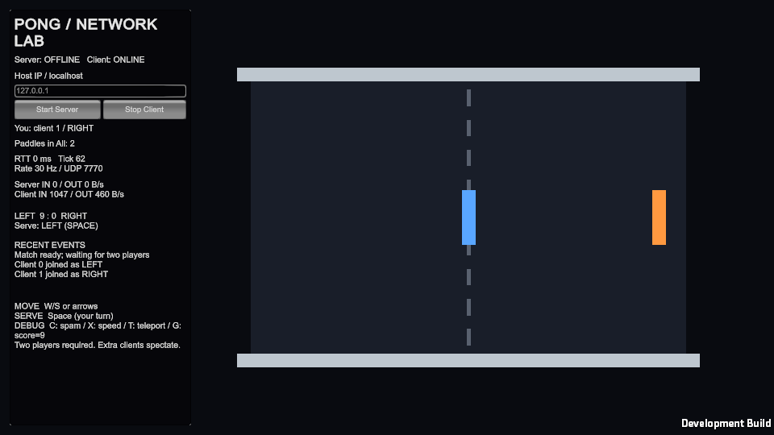
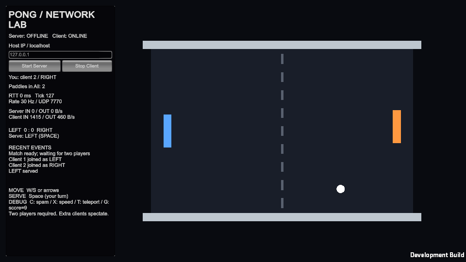

# Week 6 - Homework 3: The Host Cheats, and the Join Code

- Unity **6000.3.2f1**, FishNet **4.7.3R**, Listen Host (`Start Host` / `Stop Host`), Homework 2 server-authoritative paddles (`Client Authoritative` off, 30 ms rate limit, keys `C`, `X`, `T`).
- Added key `G` in `PaddleController.Update` (`GameState.Instance.LeftScore.Value = 9;`, direct SyncVar write with no RPC).

## Step 1 - The guest cheats

Tested with a Development-build listen host (`Start Host`) and a separate Development-build guest connecting on `127.0.0.1:7770`. Pressing `C`, `X`, `T`, `G` on the guest produced:

| Key, on the guest | Host Console | What both windows show |
|---|---|---|
| `C` | 19 `Rejected input from client 1: too fast.` lines from the burst (`rejected` 4 → 23 on tick 52) | Paddle moves at normal speed (`+0.267` m in one 30 Hz tick, speed 8) |
| `X` | Nothing extra from the cheat (`Clamp` applied silently) | Normal speed (`+0.267` m, never faster) |
| `T` | Nothing (`Server x` stayed `7.0` on every server sample) | Jumps toward ball on the guest for one snapshot, then snaps back to `x = 7.0` |
| `G` | Nothing (`Host` score stayed `0 : 0`) | Host and guest scores remain `0 : 0`; guest logs FishNet's `LogServerNotActiveWarning()` |

**Why did the host never see `G`'s SyncVar write?** FishNet `SyncVar<T>` uses server-authoritative write permissions by default: writing `LeftScore.Value = 9` on a client where `IsServerInitialized` is false is rejected locally by `SyncVar.SetValue` (logging `LogServerNotActiveWarning`), sends no packet to the server, and leaves the authoritative score unchanged.

## Step 2 - Serve rate limit

In `PaddleController.RequestServe`, added per-paddle rate limiting (`MinServeGap = 1.0`, instance field `_lastServeTime = -1`) after the null check and before the `ServingSide` check, using `[TargetRpc] private void TargetRefused(NetworkConnection target, string why)` to flash `TOO FAST` only to the requesting owner.

- Guest double-tapping Space within `0.15 s` flashed `[Client] Flash: TOO FAST` on the guest only; the host HUD did not flash.
- The host could immediately serve (`InPlay = true`) because `_lastServeTime` is an instance field (one timer per paddle, not `static`), and after waiting more than `1.0 s` the guest's next Space press was no longer refused with `TOO FAST`.

## Step 3 - The host cheats

Removed the `!IsServerInitialized` restriction on `T` in `PaddleController.Update` so `T` executes on the host as well. Pressing `C`, `X`, `T`, `G` and changing `speed` from `8` to `40` on the host window produced:

| On the host | Result | Why |
|---|---|---|
| `C` | Burst inputs rejected on the server; normal paddle speed (`8`) | `ServerSetAxis` is a `ServerRpc` request, so the 30 ms server rate check runs on the host too |
| `X` | Normal speed (`8`) | `ServerSetAxis` clamps `axis` to `[-1, 1]` on the server for the host too |
| `T` | Host's LEFT paddle jumps to `(0, 0.25, 0)` and stays there in both windows | Direct write to `transform.position` on the host writes the server's authoritative position |
| `G` | `LEFT` score becomes `9` in both host and guest windows | Direct write to `LeftScore.Value = 9` on the host runs with `IsServerInitialized == true` and replicates |
| `Speed 40` | Host's paddle moves five times faster (measured up to `56.0` u/s across frames; `40.0` u/s server step) in both windows | The server simulation in `OnTick` reads the host's own serialized `speed` field directly |

*Guest window (`client 1 / RIGHT`) showing `LEFT 9 : 0 RIGHT` after the host pressed `G`, and the host's blue paddle staying at the ball (`x = 0`) after the host pressed `T`.*

1. **Difference between `C`/`X` and `T`/`G` on the host:** `C` and `X` went through the `ServerRpc` (`ServerSetAxis`) so the server's rate limit and clamp still rejected/clamped them, whereas `T` and `G` wrote directly to the object's transform and `SyncVar` inside the process that owns server authority.
2. **Which host cheats could a guest see?** The guest sees all authoritative outcomes replicated from the server—the host's `5x` paddle speed, the `T` teleport to the ball, and the `G` score jump to `9`.
3. **Ranked game with strangers — host or dedicated server? Why?** A dedicated server, because on a listen host one player's machine holds server authority and can directly tamper with game state, speed, or rules without any server validation stopping it.

## Step 4 - Packages and the transport

- Installed **Multiplayer Services** (`com.unity.services.multiplayer` `2.0.0` from Unity Registry) and **FishyUnityTransport** (`https://github.com/ooonush/FishyUnityTransport.git?path=Assets/FishNet/Plugins/FishyUnityTransport`).
- Added `FishNet.Transporting.UTP.UnityTransport` to `NetworkManager` in `Pong.unity` with Port `7770`, and assigned `TransportManager.Transport` to `UnityTransport` (keeping `Tugboat` on `NetworkManager`, unused).
- Verified with a local Development-build host (`Start Host`) and guest (`127.0.0.1:7770`): both connected over `UnityTransport` with zero errors (`[Host] This process is the server AND a client. RTT is 0 ms.`, guest assigned `RIGHT`, `2` paddles).
- Linked Unity Cloud project `Pong` (`cloudProjectId: f3a9208b-90bd-4111-8905-d1ffef83abaf`, organization `sgoktug34`) and enabled **Relay** in the Unity Cloud dashboard.

## Step 5 - `RelayLink.cs`

Created `Pong/Assets/Scripts/Network/RelayLink.cs` (`EnsureSignedInAsync`, `HostAsync`, `JoinAsync`) using `UnityServices.InitializeAsync`, `AuthenticationService.Instance.SignInAnonymouslyAsync`, `RelayService.Instance`, and `UnityTransport.SetRelayServerData`.

1. **What does `CreateAllocationAsync` return?** A Relay `Allocation` containing the assigned Unity Relay server endpoint, allocation ID/bytes, connection data, and encryption key material for the host.
2. **What does `GetJoinCodeAsync` return?** A short six-character join code string mapped to that active Relay allocation so guests can look it up without knowing any IP address.
3. **Why is `SetRelayServerData` before `StartConnection`?** Calling `SetRelayServerData` switches `UnityTransport` to `ProtocolType.RelayUnityTransport` and supplies the Relay endpoint and credentials that `StartServer()` / `StartClient()` immediately bind to when `StartConnection()` runs.

## Step 6 - Two buttons and a code

Updated `Pong/Assets/Scripts/Tools/ConnectionHud.cs` with `_joinCode`, `_relayCode`, `_relayBusy`, `HostViaRelay()`, and `JoinViaRelay()`:

- When both server and client are `Stopped` and `_relayBusy` is `false`, the HUD renders **Host via Relay**, the join-code text box, and **Join via Relay** (and hides connection buttons while `_relayBusy` is `true`).
- Typing in the join-code field sets `ConnectionHud.EditingAddress` so `W`/`S`/`C`/`X`/`T`/`G` keys do not trigger while entering a code.
- When `_relayCode` is non-empty and the server is `Started`, the HUD displays a large `JOIN CODE: <code>` label; clicking **Stop Host** (or **Stop Server**) clears `_relayCode = ""`.
- Verified live Unity Relay end-to-end between two processes on one Mac (`-pongProfile host` and `-pongProfile guest`): the host allocated Relay join code `8NLCF6` (`[Host] This process is the server AND a client. RTT is 0 ms.`), the guest joined via Relay as `client 2 / RIGHT`, and `LEFT served` replicated the active white ball (`inPlay = true`) to the guest window (`Client IN 1415 / OUT 460 B/s`).

*Guest window (`client 2 / RIGHT`) connected through live Unity Relay join code `8NLCF6` during an active serve.*

## Step 7 - Your partner, from another network

| Field | Value |
|---|---|
| Partner's name | Can |
| Who hosted, who joined | Sıraç hosted (`Host via Relay`), Can joined (`Join via Relay`) |
| The two networks | Home Wi-Fi (host) and School network (guest) |
| Guest RTT through the Relay | Exact ms value not recorded during the session (higher than the `7–33 ms` loopback baseline due to two-hop Relay routing) |
| Guest RTT on `127.0.0.1` (Step 6) | `7–33 ms` (same-machine loopback baseline) |
| First try? If not, which fix line | Yes (connected on the first try) |

*Note: No separate screenshot was captured from Can's guest window during the home-to-school session; the verified Relay guest view (`week06-relay-guest.png`) from the local Relay test is shown in Step 6 above.*

1. **Who connects to whom through the Relay?** Both the host and the guest make outbound connections to Unity's public Relay server, and the Relay server forwards encrypted UDP packets between them.
2. **Why did no router need a change?** Neither player accepts unsolicited inbound traffic on their home or mobile router—both initiate outbound UDP sessions to the Relay server, so NAT keeps the return path open automatically.
3. **Why does the guest's paddle feel later than in Step 6?** Packets travel from the guest to the Relay server, then to the host, and back along the same two-hop internet path, adding real geographic internet latency across both hops on top of the local tick delay.

## Hand-in status

- [x] `Before you start` & `Week06/README.md` (`Homework 3: start`).
- [x] Step 1: guest `G` score-edit cheat added and verified alongside `C`, `X`, `T` (`Homework 3: guest cheats fail`).
- [x] Step 2: 1 s per-paddle serve rate limit + `[TargetRpc] TargetRefused` (`TOO FAST`) verified (`Homework 3: serve rate limit`).
- [x] Step 3: host `C`, `X`, `T`, `G`, `Speed 40` verified; guest screenshot captured and questions answered (`Homework 3: host cheats work`).
- [x] Step 4: `Multiplayer Services` + `FishyUnityTransport` installed, `UnityTransport` wired on Port 7770 (`Homework 3: UnityTransport`).
- [x] Step 5 & 6: `RelayLink.cs` and `ConnectionHud.cs` Relay UI implemented, linked to Unity Cloud Relay, and verified live (`8NLCF6`) between host and guest (`Homework 3: join code`).
- [x] Step 7: partner connection card filled for the two-network Relay test with Can (Home Wi-Fi ↔ School network, connected first try; exact guest RTT/screenshot from that session not recorded) (`Homework 3: done`).
